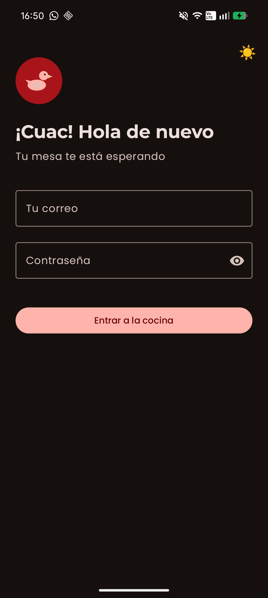
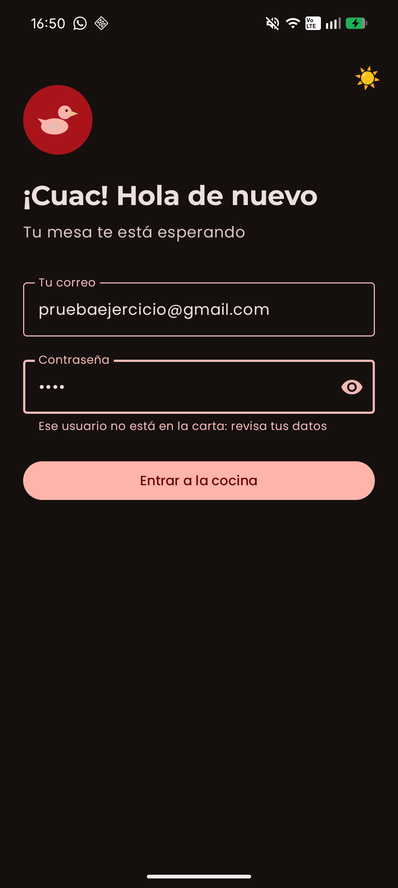
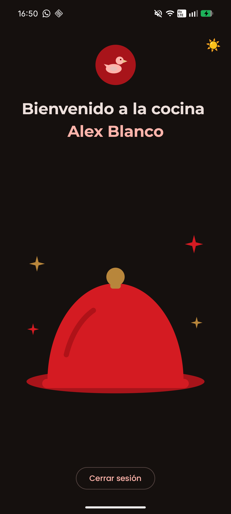
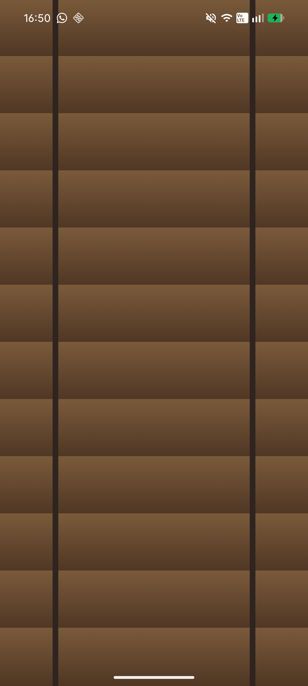
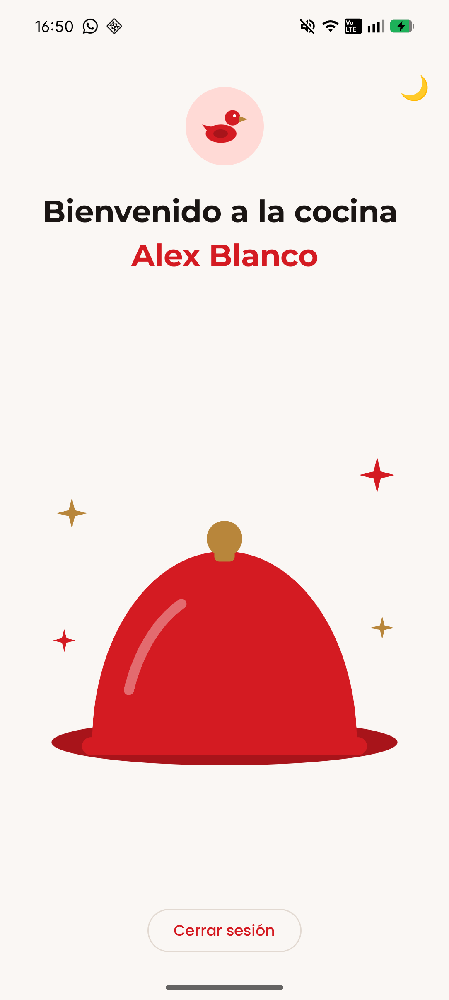

# Pato - App de acceso (Login y Bienvenida)

Tarea de 2.º DAM · Programación multimedia y dispositivos móviles
Alumno: Alex Blanco

App Android hecha con **Kotlin, Jetpack Compose y Material 3**. Tiene una pantalla de login y una de bienvenida. Está inspirada en la plantilla *pato* (un restaurante), de ahí el logo del pato, la campana de plato y los colores rojo y dorado.

## Datos de prueba

No hay servidor ni base de datos, los datos están escritos en el código (`LoginScreen.kt`).

| Dato | Valor |
|---|---|
| Correo | `pruebaejercicio@gmail.com` |
| Contraseña | `1234` |
| Nombre que sale en la bienvenida | Alex Blanco |

## Capturas

| Login (modo oscuro) | Error | Bienvenida (modo oscuro) |
|---|---|---|
|  |  |  |

| Persiana al cambiar de modo | Bienvenida (modo claro) |
|---|---|
|  |  |

## Cómo funciona

1. En el login se escribe el correo y la contraseña.
2. Si son correctos, se pasa a la bienvenida y se le envía el nombre como parámetro.
3. Si no, sale un mensaje de error y no se cambia de pantalla.
4. El botón **Cerrar sesión** vuelve al login con los campos vacíos y sin error.

## Decisiones de diseño

- **Colores:** sacados de la plantilla pato (rojo `#D41B22`, dorado `#B8863B`, fondo crema `#FAF7F4`). Están definidos como roles de Material 3 en `Color.kt` y `Theme.kt`.
- **Tipografía:** Montserrat para los títulos y Poppins para el resto (las dos de pato).
- **Logo:** un pato dibujado con `Canvas` (`LogoPato.kt`).
- **Ilustración de la bienvenida:** una campana de plato con su bandeja y destellos, también con `Canvas`.
- **Textos:** con un tono de restaurante ("Entrar a la cocina", "Ese usuario no está en la carta...").

## Extras

- **Modo oscuro:** hay un esquema de colores oscuro que se activa según el modo del móvil.
- **Botón de modo claro/oscuro:** arriba a la derecha (🌙 / ☀️) para cambiar de modo sin salir de la app.
- **Transición de persiana:** al cambiar de modo, una persiana de madera (dibujada con `Canvas`) se cierra y se abre de arriba a abajo.
- **Transición animada** entre las dos pantallas (`AnimatedContent`: una desliza y se funde mientras sale la otra).
- **Validación del formulario:** avisa si el correo no tiene formato válido, si la contraseña es muy corta o si los datos no coinciden.
- **Componentes propios reutilizables:** `LogoCircular` y `LogoPato` se usan en las dos pantallas.

## Estructura del proyecto

```
app/src/main/java/com/alejandroblanco/login_compose/
  MainActivity.kt        decide qué pantalla se ve
  ui/
    LoginScreen.kt       pantalla de login
    WelcomeScreen.kt     pantalla de bienvenida
    LogoCircular.kt      círculo con el logo
    LogoPato.kt          pato dibujado con Canvas
    BotonModo.kt         botón para cambiar claro/oscuro
    Persiana.kt          persiana de la transición
    theme/
      Color.kt           colores (claro y oscuro)
      Theme.kt           tema de Material 3
      Type.kt            fuentes
```

## Cómo ejecutarla

1. Abrir la carpeta del proyecto con Android Studio.
2. Esperar a que termine la sincronización de Gradle.
3. Ejecutar en un emulador o en un móvil con el botón de play (minSdk 26).

## Figma

Enlace al diseño: _(pendiente de poner)_
